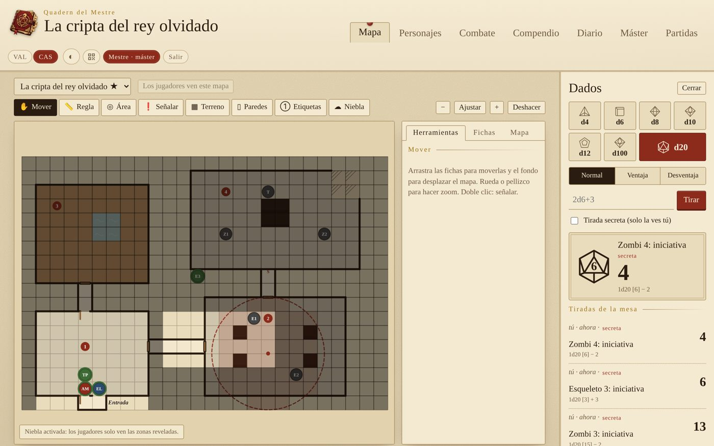
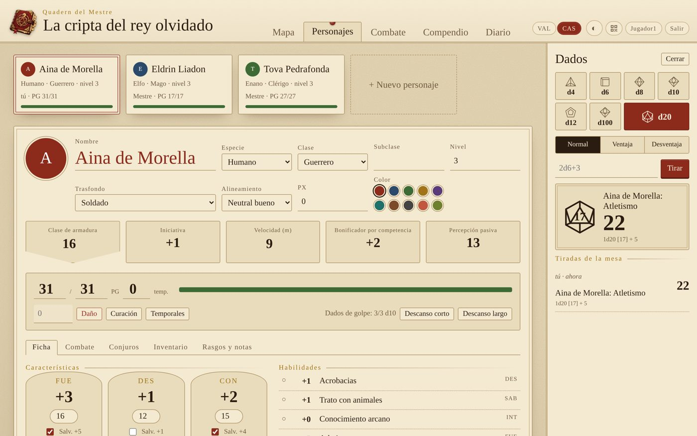
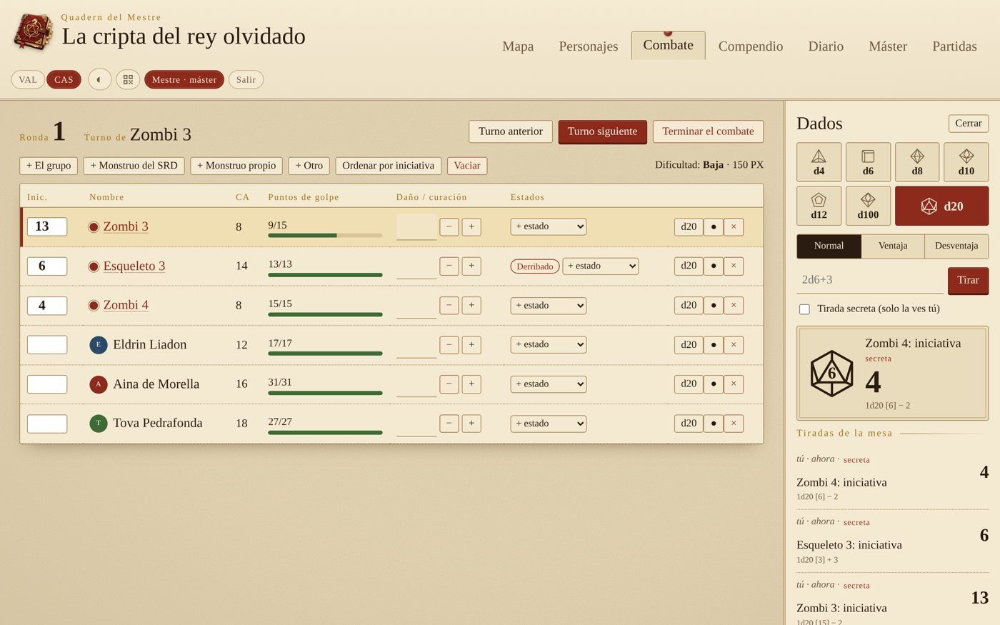
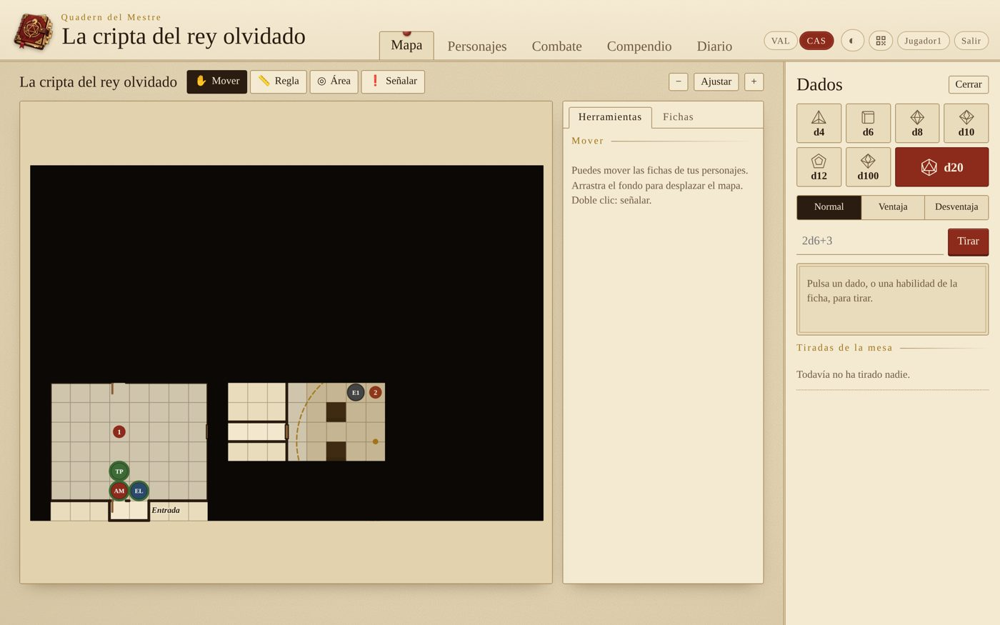

<p align="center"></p>

[Valencià](README.md) · **Castellano**

Ayudante libre para dirigir partidas de rol de **5.ª edición** en casa, en castellano y valenciano. Un ordenador hace de servidor y el resto de la mesa entra desde el navegador, móviles incluidos. Todo va en un solo archivo y no necesita Internet.



## Qué hace

- **Editor de mapas**
  - Imagen de fondo (de Dungeondraft, Inkarnate, un escaneo…) con la cuadrícula ajustable al dibujo.
  - Pintar terreno (pincel, rectángulo y rellenar), paredes, puertas, puertas secretas y ventanas.
  - Números de sala y etiquetas.
  - **Niebla de guerra**: el máster revela zonas y los jugadores no reciben nada de lo que hay debajo, ni las fichas ocultas.
  - Fichas de personajes y monstruos, con la vida en el anillo. Cada jugador mueve las suyas.
  - **Regla** en metros y **áreas de efecto** (esfera, cono, línea y cubo) que marcan las casillas afectadas.
  - Señalar un punto del mapa y deshacer los cambios.
- **Fichas de personaje** completas (reglas de 2024): características, habilidades, salvaciones, PG, ataques, conjuros con espacios, inventario, monedas, estados, descansos y retrato. Todas las tiradas se hacen desde la ficha.
- **Combate**: iniciativa, turnos y rondas, daño y curación, estados y monstruos ocultos. Calcula la dificultad del encuentro. Los jugadores ven «Herido» o «Malherido» en lugar de los PG de los monstruos.
- **Compendio del SRD 5.2.1** con la traducción oficial al castellano: 330 criaturas, 339 conjuros, objetos mágicos, estados, equipo, clases y reglas. Incluye un preparador de encuentros y monstruos propios.
- **Diario de sesiones** que escribe toda la mesa, y **documentos** (cartas, pistas, imágenes) que el máster enseña cuando quiere.
- **Pestaña del máster**: generadores de nombres, PNJ, tabernas, botín y encuentros, tablas aleatorias propias y notas secretas.
- **Dados** compartidos, con ventaja, desventaja y tiradas secretas del máster.
- **Varias partidas guardadas**, una partida de ejemplo, entrada con **QR**, **modo oscuro** y adaptado al **móvil**.

<p>
  
  
</p>
<p>
  
  
</p>

## Cómo se usa

### En Windows, sin instalar nada

Descarga `QuadernDelMestre-windows.zip` de la sección [Releases](../../releases), descomprímelo y haz doble clic en `QuadernDelMestre.exe`. Se abre una ventana con la dirección, la contraseña del máster y el QR, y el navegador ya con la app. Windows puede avisar de que es un programa de un editor desconocido: pulsa «Más información» y «Ejecutar de todas formas».

### Con Python (Linux, Mac o Windows)

Solo hace falta **Python 3.8 o más nuevo**. No hay que instalar nada más.

```bash
python3 quadern.py
```

Al arrancar, muestra (los mensajes de la terminal están en valenciano):
- la dirección para los demás, por ejemplo `http://192.168.1.40:8767`, en la línea «Des de la xarxa»;
- la **contraseña del máster**, en la línea «Contrasenya del màster»;
- un **código QR** para entrar desde el móvil.

Quien quiere ser máster marca «Soy el máster» y escribe la contraseña. Los jugadores entran solo con el nombre. Para probarlo todo enseguida, ve a **Partidas → Crear la partida de ejemplo**.

Opciones:

```bash
python3 quadern.py --contrasenya dragon     # elige la contraseña del máster
python3 quadern.py --port 9002              # otro puerto
python3 quadern.py --partida "La cripta"    # abre (o crea) esa partida
python3 quadern.py --sense-qr               # no muestra el QR en la terminal
```

En [docs/Guia-Quadern-del-Mestre-es.pdf](docs/Guia-Quadern-del-Mestre-es.pdf) tienes la **guía de uso completa**, con capturas de todas las pantallas.

## Los datos

Cada partida se guarda en `partides/<nombre>.json`, y sus imágenes en `partides/<nombre>-fitxers/`. Los jugadores, las sesiones y la contraseña del máster se guardan en `quadern.json`. Para hacer una copia de seguridad, cópialo todo.

## Modificar el programa

`quadern.py` se genera a partir de los archivos de `src/`:

| Archivo | Qué contiene |
|---|---|
| `src/servidor.py` | El servidor (Python, sin dependencias): permisos del máster, niebla de guerra, imágenes |
| `src/qr.py` | El generador de códigos QR |
| `src/srd/srd-es.json.gz` | El compendio SRD 5.2.1 en castellano |
| `src/web/nucli.js`, `daus.js` | Utilidades, idioma, conexión, ventanas y dados |
| `src/web/mapa.js` | El editor de mapas |
| `src/web/fitxes.js`, `combat.js`, `compendi.js` | Fichas, combate y compendio |
| `src/web/diari.js`, `master.js`, `partides.js` | Diario y documentos, pestaña del máster, partidas |
| `src/web/dades.js` | Reglas: habilidades, estados, clases, espacios de conjuro, PX, generadores |
| `src/web/i18n.js` | Las traducciones al castellano (para añadir un idioma, copia el bloque `es`) |

Después de cambiar algo:

```bash
python3 build.py                          # vuelve a generar quadern.py
python3 eines/comprova-traduccions.py     # comprueba que no falta ninguna traducción
```

### Publicar una versión para Windows

El ejecutable lo hace GitHub automáticamente ([`.github/workflows/windows-exe.yml`](.github/workflows/windows-exe.yml)). Solo hay que subir una etiqueta en minúscula:

```bash
git tag v1.0
git push origin v1.0
```

Al cabo de unos minutos, `QuadernDelMestre-windows.zip` aparece en [Releases](../../releases).

Las propuestas de mejora y las correcciones son bienvenidas.

## Licencia

[GPL-3.0](LICENSE) o posterior. Lo podéis usar, copiar, modificar y compartir libremente. Si publicáis una versión modificada, también tiene que ser libre y con el código abierto.

El compendio incluye material del **SRD 5.2.1** de Wizards of the Coast LLC, con licencia [Creative Commons Reconocimiento 4.0](https://creativecommons.org/licenses/by/4.0/legalcode). Los detalles y el texto de atribución completo están en [NOTICE.md](NOTICE.md).

## Uso de inteligencia artificial

Este proyecto se ha hecho con ayuda de IA:
- **Imágenes:** el logo se ha generado con IA.
- **Código y documentación:** el programa, las traducciones, los README y las guías se han escrito con un asistente de IA y se han revisado a mano.

## Aviso

Proyecto de fans **no oficial**, sin relación con Wizards of the Coast. «Dungeons & Dragons» y «D&D» son marcas de sus propietarios. El programa solo incluye el material libre del SRD 5.2.1.
