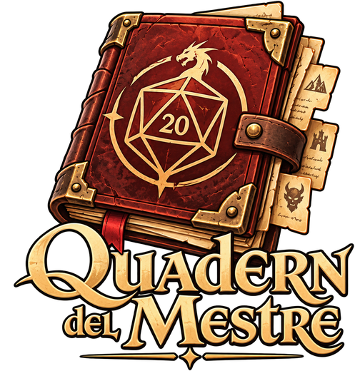
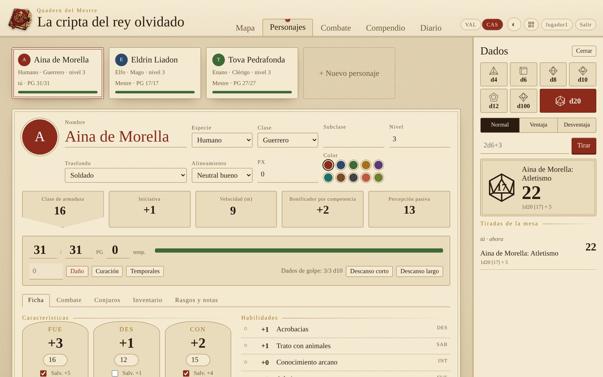
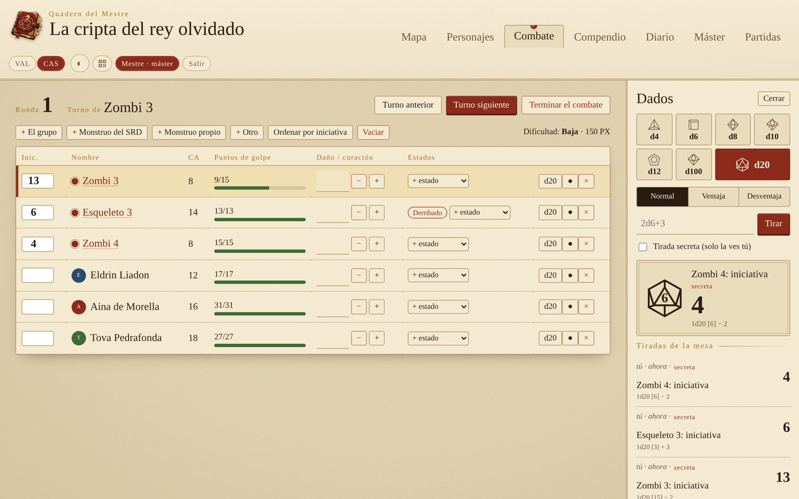
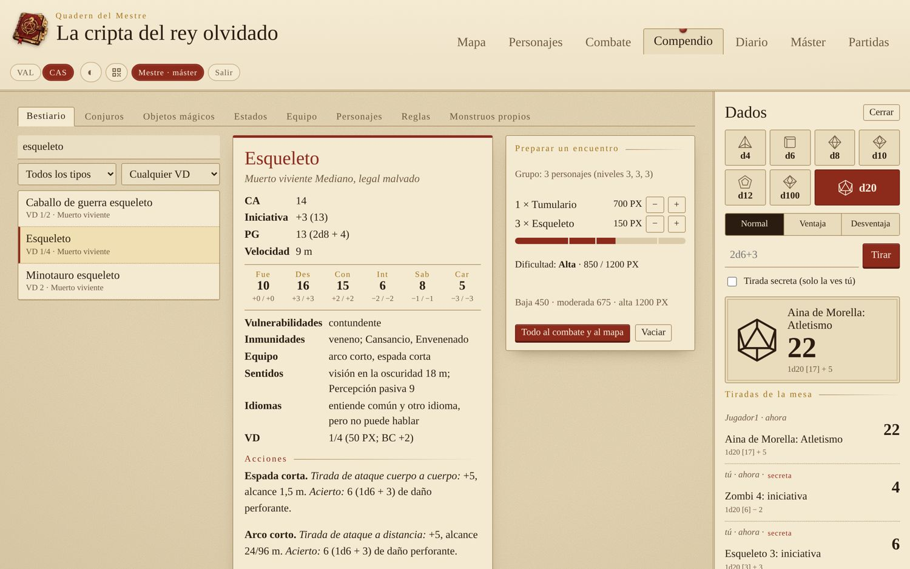

<p align="center"></p>

<p align="center">
  <a href="../../releases/latest"></a>
  <a href="LICENSE"></a>
  
  
</p>

[Valencià](README.md) · **Castellano**

# Quadern del Mestre

**Ayudante libre para dirigir partidas de rol de 5.ª edición en casa.** Un ordenador hace de servidor y el resto de la mesa entra desde el navegador, móviles incluidos: mapas con niebla de guerra, fichas de personaje, combate, el compendio SRD 5.2.1, diario y documentos. En castellano y valenciano, y sin Internet.

Funciona en **Windows y Linux**. Se instala como cualquier otro programa y las partidas se quedan en el ordenador de casa.

🌐 **Web:** [jossanmar9.github.io/quadern-del-mestre](https://jossanmar9.github.io/quadern-del-mestre/es/) · ⬇️ **Descarga:** [última versión](../../releases/latest) · 📖 **Manual:** [en línea](docs/manual-usuario.md) y en PDF en cada versión


## Contenido

- [Qué hace](#qué-hace)
- [Capturas](#capturas)
- [Instalación](#instalación)
- [Primeros pasos](#primeros-pasos)
- [Datos y copias de seguridad](#datos-y-copias-de-seguridad)
- [Documentación](#documentación)
- [Para desarrollar](#para-desarrollar)
- [Publicar una versión](#publicar-una-versión)
- [Colaborar](#colaborar)
- [Uso de inteligencia artificial](#uso-de-inteligencia-artificial)
- [Licencia](#licencia)

## Qué hace

| Sección | Qué hace |
|---|---|
| **Mapa** | Imagen de fondo (Dungeondraft, Inkarnate, un escaneo…) con la cuadrícula ajustable, o dibujado a mano: terreno, paredes, puertas, puertas secretas, ventanas, salas y etiquetas. Fichas con la vida en el anillo; cada jugador mueve las suyas. **Regla** en metros y **áreas de efecto** (esfera, cono, línea y cubo). |
| **Niebla de guerra** | El máster revela zonas a mano, o deja que se revelen solas con lo que ven los personajes (las paredes, las puertas cerradas, la roca y los árboles tapan la vista). Los jugadores no reciben nada de lo que hay debajo, ni las fichas ocultas. |
| **Personajes** | Fichas completas con las reglas de 2024: características, habilidades, salvaciones, PG, ataques, conjuros con espacios, inventario, monedas, estados, descansos y retrato. Todas las tiradas se hacen desde la ficha. **Subir de nivel** guiado: PG, competencia, espacios de conjuro y rasgos de clase. |
| **Combate** | Iniciativa, turnos y rondas, daño y curación, estados con **duración en rondas** y monstruos ocultos. Tira sola la salvación de **concentración** cuando hace falta. Calcula la dificultad del encuentro. Los jugadores ven «Herido» o «Malherido» en lugar de los PG de los monstruos. |
| **Compendio** | El SRD 5.2.1 con la traducción oficial al castellano: 330 criaturas, 339 conjuros, objetos mágicos, estados, equipo, clases y reglas. Preparador de encuentros y monstruos propios. |
| **Diario** | Un diario de sesiones que escribe toda la mesa, y documentos (cartas, pistas, imágenes) que el máster enseña cuando quiere. |
| **Máster** | Generadores de nombres, PNJ, tabernas, botín y encuentros, tablas aleatorias propias, notas secretas y **música y ambiente** (lluvia, tormenta, hoguera, cueva… y tus pistas). |
| **Partidas** | Varias partidas guardadas, **copias de seguridad automáticas**, **exportar e importar** partidas en un `.zip`, dos partidas de ejemplo y la contraseña del máster. |

Además: **dados** compartidos con ventaja, desventaja y tiradas secretas, un **lápiz** para dibujar sobre el mapa, entrada con **QR**, **modo oscuro** y adaptado al **móvil**. Si se pierde la conexión, lo avisa y guarda los cambios cuando vuelve. Todo el programa está en **castellano y valenciano**, y cada jugador elige su idioma.

## Capturas

| | |
|---|---|
|  |  |
| Una ficha de personaje, con todas las tiradas a un clic. | El combate: iniciativa, turnos, puntos de golpe y estados. |
|  |  |
| El bestiario y el preparador de encuentros. | El mismo mapa, visto por un jugador. |

Hay más capturas, paso a paso, en el [manual de usuario](docs/manual-usuario.md).

## Instalación

**Requisitos:** Windows 10 u 11 de 64 bits, o Linux con escritorio, y unos 50 MB de disco. Los jugadores solo necesitan un navegador y estar en la misma wifi. No hace falta Internet.

Descarga la [última versión](../../releases/latest):

| Sistema | Archivo |
|---|---|
| **Windows** (recomendado) | `QuadernDelMestre-X.Y-installador.exe`. No pide permisos de administrador; crea el acceso en el menú Inicio y, si quieres, en el escritorio. |
| **Windows** portable | `QuadernDelMestre-X.Y-windows-portable.zip`. Descomprímelo donde quieras (también en un lápiz USB) y abre `QuadernDelMestre.exe`. |
| **Ubuntu, Debian, Linux Mint…** | `quadern-del-mestre_X.Y_all.deb`. Doble clic para instalarlo, o `sudo apt install ./quadern-del-mestre_X.Y_all.deb`. |
| **Otros Linux** | `QuadernDelMestre-X.Y-linux.tar.gz`. Descomprímelo y abre `quadern-del-mestre.sh`; `./installa.sh` lo añade al menú. Hace falta Python 3 y, para la ventana, Tk. |

El programa no está firmado digitalmente: en Windows, SmartScreen puede avisar. Pulsa **Más información → Ejecutar de todas formas**. La primera vez, permítele el acceso a las **redes privadas** para que puedan entrar los jugadores.

Más detalles, el cortafuegos de Linux y cómo pasar las partidas de la versión 1.0, en la [guía de instalación](docs/guia-instalacion.md).

**Sin instalar nada** (Linux, Mac o Windows con Python 3.8 o más nuevo): descarga [`quadern.py`](quadern.py) y ejecuta `python3 quadern.py`.

## Primeros pasos

1. Abre **Quadern del Mestre**. Se abre una ventanita con la dirección para los demás, un **código QR** y la **contraseña del máster**, y el navegador ya con la app. Mientras la ventana esté abierta, el Quadern funciona; al cerrarla, lo guarda todo y se detiene.
2. Quien quiera ser máster marca «Soy el máster» y escribe la contraseña. Los jugadores escanean el QR con el móvil y entran solo con el nombre.
3. Para probarlo todo enseguida, ve a **Partidas → Crear la partida de ejemplo**.

Opciones para el terminal:

```bash
quadern-del-mestre --contrasenya drac      # elige la contraseña del máster
quadern-del-mestre --port 9002             # otro puerto (el normal es el 8767)
quadern-del-mestre --partida "La cripta"   # abre (o crea) esa partida
quadern-del-mestre --dades ~/Partidas      # guarda las partidas en otra carpeta
quadern-del-mestre --sense-finestra        # sin ventana: todo en el terminal, con el QR
quadern-del-mestre --idioma es             # la ventana en castellano (por defecto, en valenciano)
```

(En Windows, `QuadernDelMestre.exe`; con el `.tar.gz`, `./quadern-del-mestre.sh`; sin instalar, `python3 quadern.py`.)

## Datos y copias de seguridad

| Cómo está instalado | Dónde se guardan las partidas |
|---|---|
| Windows, con el instalador | `%APPDATA%\QuadernDelMestre` |
| Linux, con el `.deb` | `~/.local/share/quadern-del-mestre` |
| Windows portable, `.tar.gz` o `python3 quadern.py` | La carpeta del programa |

Cada partida se guarda en `partides/<nombre>.json`, y sus imágenes y sonidos en `partides/<nombre>-fitxers/`. Los jugadores, las sesiones y la contraseña del máster van a `quadern.json`. El botón **Carpeta de partidas** de la ventana abre la carpeta. Al desinstalar, las partidas no se borran.

El Quadern hace **copias de seguridad** solo en `copies/`: una cada vez que se abre una partida y una cada media hora mientras se juega (guarda las 15 últimas). Se restauran desde **Partidas → Copias**. Para pasar una partida a otro ordenador, **Exportar** e **Importar una partida**.

## Documentación

| Documento | Castellano | Valencià |
|---|---|---|
| Manual de usuario | [manual-usuario.md](docs/manual-usuario.md) | [manual-usuari.md](docs/manual-usuari.md) |
| Guía de instalación | [guia-instalacion.md](docs/guia-instalacion.md) | [guia-installacio.md](docs/guia-installacio.md) |

Los PDF se generan solos a partir de estos archivos y van adjuntos a cada [versión](../../releases/latest), dentro de los paquetes y en la [web](https://jossanmar9.github.io/quadern-del-mestre/es/).

## Para desarrollar

Solo hace falta **Python 3.8 o más nuevo**, sin dependencias. `quadern.py` se genera a partir de `src/`:

| Archivo | Qué hay |
|---|---|
| `src/servidor.py` | El servidor: permisos del máster, niebla de guerra y línea de visión, imágenes y sonidos, copias, exportar e importar |
| `src/finestra.py` | La ventanita con la dirección, el QR y la contraseña (Tk) |
| `src/qr.py` | El generador de códigos QR |
| `src/srd/srd-es.json.gz` | El compendio SRD 5.2.1 en castellano |
| `src/web/nucli.js`, `daus.js` | Utilidades, idioma, conexión, ventanas y dados |
| `src/web/mapa.js` | El editor de mapas |
| `src/web/fitxes.js`, `combat.js`, `compendi.js` | Fichas, combate y compendio |
| `src/web/diari.js`, `master.js`, `so.js`, `partides.js` | Diario y documentos, pestaña del máster, música y ambiente, partidas |
| `src/web/dades.js` | Reglas: habilidades, estados, clases, espacios de conjuro, PX, generadores |
| `src/web/i18n.js` | Las traducciones al castellano (para añadir un idioma, copia el bloque `es`) |
| `docs/` | Los manuales en Markdown y las capturas |
| `tests/` | Las pruebas automáticas del servidor |
| `paquets/` | El instalador de Windows (Inno Setup) y los archivos del menú de Linux |
| `eines/` | Comprobar traducciones, hacer los manuales en PDF, los paquetes de Linux y la web |

Después de cambiar algo:

```bash
python3 build.py                          # vuelve a generar quadern.py
python3 eines/comprova-traduccions.py     # comprueba que no falta ninguna traducción
python3 tests/prova_servidor.py           # pruebas: permisos, niebla, copias, exportar e importar…
python3 quadern.py                        # pruébalo
```

Otras herramientas:

```bash
python3 eines/paquet-linux.py             # hace el .deb y el .tar.gz en dist/
sh eines/manuals-pdf.sh dist/manuals      # hace los manuales en PDF (hace falta Chrome o Chromium)
python3 eines/web.py _site                # genera la web
```

## Publicar una versión

Cada cambio que se sube a `main` pasa las pruebas en Windows y Linux ([`.github/workflows/proves.yml`](.github/workflows/proves.yml)).

GitHub lo hace todo solo con [`.github/workflows/publica.yml`](.github/workflows/publica.yml): prueba el programa, hace el instalador y el portable de Windows, el `.deb` y el `.tar.gz` de Linux y los manuales en PDF, y lo publica en [Releases](../../releases).

1. Cambia `VERSION` en `src/servidor.py` (por ejemplo, `"1.2"`) y vuelve a generar `quadern.py` con `python3 build.py`.
2. Sube los cambios y una etiqueta en minúscula con el mismo número:

```bash
git tag v1.2
git push origin main v1.2
```

Al cabo de unos minutos, la nueva versión aparece en [Releases](../../releases). Si la etiqueta y `VERSION` no coinciden, la publicación se detiene y lo avisa.

La [web](https://jossanmar9.github.io/quadern-del-mestre/es/) se publica sola con [`.github/workflows/web.yml`](.github/workflows/web.yml) cada vez que se suben cambios a `main` (hace falta **Settings → Pages → Source: GitHub Actions**).

## Colaborar

Las propuestas de mejora y las correcciones son bienvenidas. Si has encontrado un error o tienes una idea, abre una [incidencia](../../issues/new/choose): hay un formulario para errores y otro para propuestas, en castellano y valenciano.

## Uso de inteligencia artificial

Este proyecto se ha hecho con ayuda de IA:
- **Imágenes:** el logo se ha generado con IA.
- **Código y documentación:** el programa, las traducciones, los README, los manuales, los paquetes y la web se han escrito con un asistente de IA (Claude, de Anthropic) y se han revisado a mano.

## Licencia

[GPL-3.0](LICENSE) o posterior. Lo podéis usar, copiar, modificar y compartir libremente. Si publicáis una versión modificada, también debe ser libre y con el código abierto.

El compendio incluye material del **SRD 5.2.1** de Wizards of the Coast LLC, con licencia [Creative Commons Reconocimiento 4.0](https://creativecommons.org/licenses/by/4.0/legalcode). Los detalles y el texto de atribución completo están en [NOTICE.md](NOTICE.md).

**Aviso:** proyecto de fans **no oficial**, sin relación con Wizards of the Coast. «Dungeons & Dragons» y «D&D» son marcas de sus propietarios. El programa solo incluye el material libre del SRD 5.2.1.
