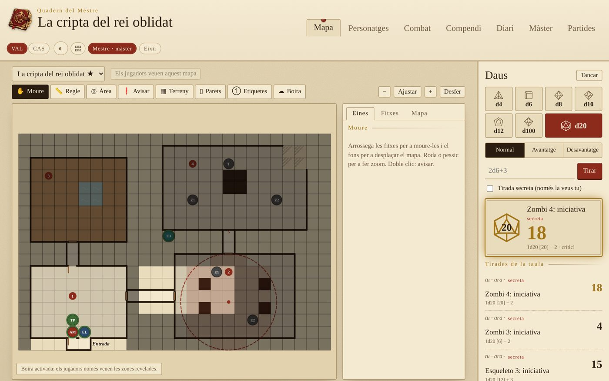
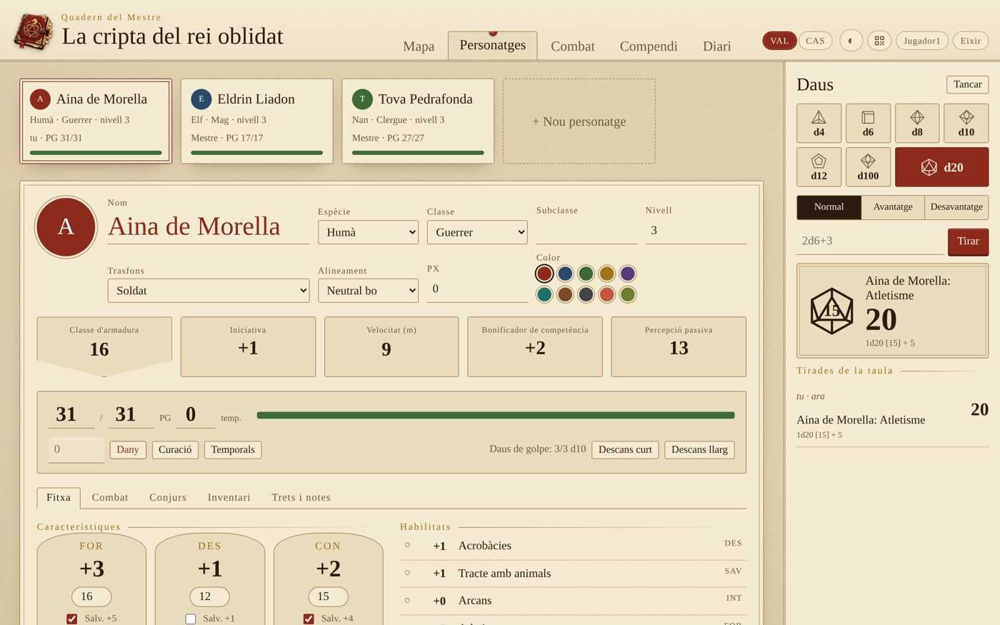
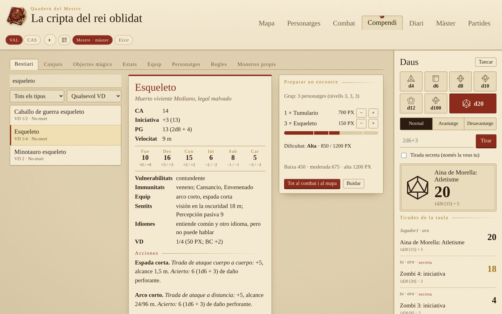
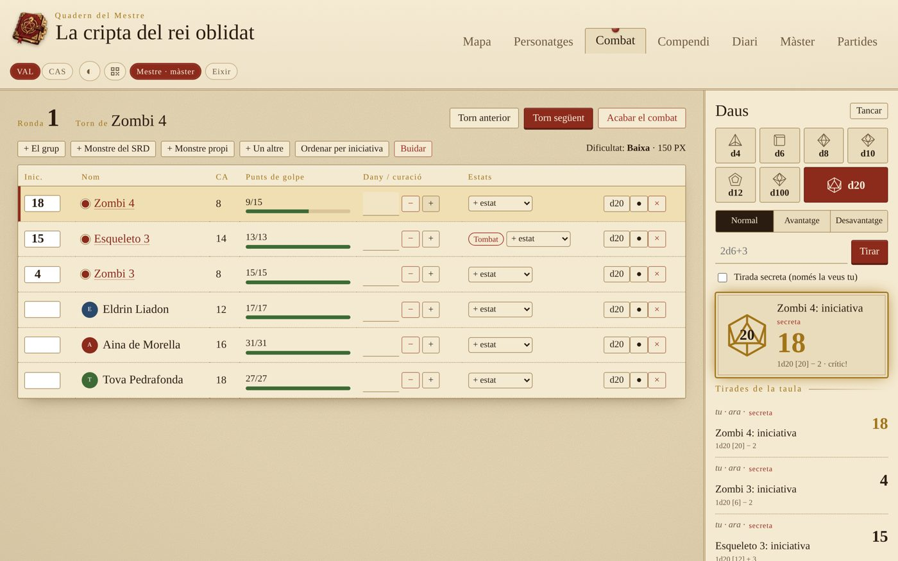
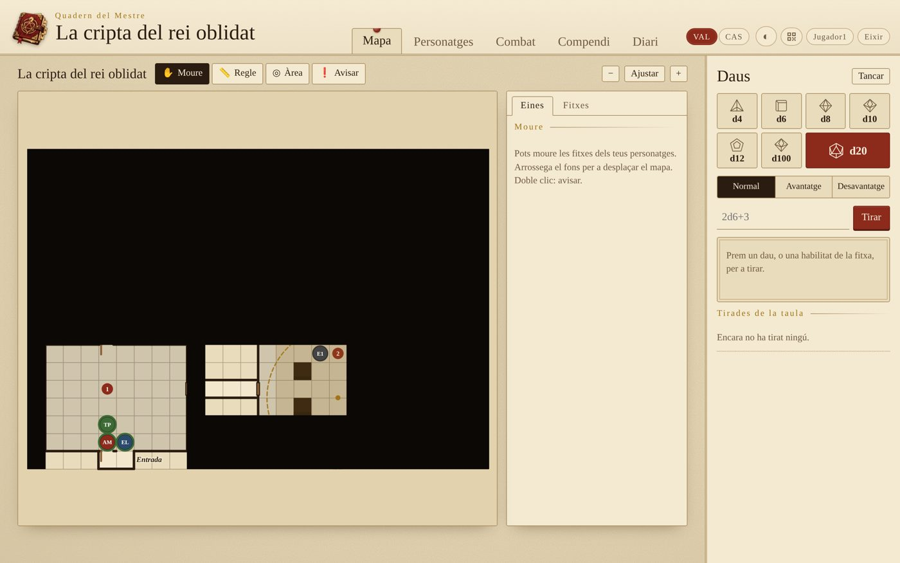

<p align="center"></p>

**Valencià** · [Castellano](README.es.md)

Ajudant lliure per a dirigir partides de rol de **5a edició** a casa, en valencià i castellà. Un ordinador fa de servidor i la resta de la taula hi entra des del navegador, mòbils inclosos. Tot va en un sol fitxer i no necessita Internet.



## Què fa

- **Editor de mapes**
  - Imatge de fons (de Dungeondraft, Inkarnate, un escaneig…) amb la quadrícula ajustable al dibuix.
  - Pintar terreny (pinzell, rectangle i omplir), parets, portes, portes secretes i finestres.
  - Números de sala i etiquetes.
  - **Boira de guerra**: el màster revela zones i els jugadors no reben res del que hi ha davall, ni les fitxes amagades.
  - Fitxes de personatges i monstres, amb la vida a l'anell. Cada jugador mou les seues.
  - **Regle** en metres i **àrees d'efecte** (esfera, con, línia i cub) que marquen les caselles afectades.
  - Avisar en un punt del mapa i desfer els canvis.
- **Fitxes de personatge** completes (regles de 2024): característiques, habilitats, salvacions, PG, atacs, conjurs amb espais, inventari, monedes, estats, descansos i retrat. Totes les tirades es fan des de la fitxa.
- **Combat**: iniciativa, torns i rondes, dany i curació, estats i monstres amagats. Calcula la dificultat de l'encontre. Els jugadors veuen «Ferit» o «Malferit» en compte dels PG dels monstres.
- **Compendi del SRD 5.2.1** amb la traducció oficial al castellà: 330 criatures, 339 conjurs, objectes màgics, estats, equip, classes i regles. Inclou un preparador d'encontres i monstres propis.
- **Diari de sessions** que escriu tota la taula, i **documents** (cartes, pistes, imatges) que el màster ensenya quan vol.
- **Pestanya del màster**: generadors de noms, PNJ, tavernes, botí i encontres, taules aleatòries pròpies i notes secretes.
- **Daus** compartits, amb avantatge, desavantatge i tirades secretes del màster.
- **Diverses partides guardades**, una partida d'exemple, entrada amb **QR**, **mode fosc** i adaptat al **mòbil**.

<p>
  
  
</p>
<p>
  
  
</p>

## Com s'usa

### A Windows, sense instal·lar res

Baixa `QuadernDelMestre-windows.zip` de la secció [Releases](../../releases), descomprimeix-lo i fes doble clic a `QuadernDelMestre.exe`. S'obri una finestra amb l'adreça, la contrasenya del màster i el QR, i el navegador ja amb l'app. Windows pot avisar que és un programa d'un editor desconegut: prem «Més informació» i «Executa igualment».

### Amb Python (Linux, Mac o Windows)

Només cal **Python 3.8 o més nou**. No s'ha d'instal·lar res més.

```bash
python3 quadern.py
```

En arrancar, mostra:
- l'adreça per als altres, per exemple `http://192.168.1.40:8767`;
- la **contrasenya del màster**;
- un **codi QR** per a entrar des del mòbil.

Qui vol ser màster marca «Sóc el màster» i escriu la contrasenya. Els jugadors entren només amb el nom. Per a provar-ho tot de seguida, ves a **Partides → Crear la partida d'exemple**.

Opcions:

```bash
python3 quadern.py --contrasenya drac       # tria la contrasenya del màster
python3 quadern.py --port 9002              # un altre port
python3 quadern.py --partida "La cripta"    # obri (o crea) eixa partida
python3 quadern.py --sense-qr               # no mostra el QR a la terminal
```

A [docs/Guia-Quadern-del-Mestre.pdf](docs/Guia-Quadern-del-Mestre.pdf) tens la **guia d'ús completa**, amb captures de totes les pantalles. En castellà: [docs/Guia-Quadern-del-Mestre-es.pdf](docs/Guia-Quadern-del-Mestre-es.pdf).

## Les dades

Cada partida es guarda a `partides/<nom>.json`, i les seues imatges a `partides/<nom>-fitxers/`. Els jugadors, les sessions i la contrasenya del màster es guarden a `quadern.json`. Per a fer una còpia de seguretat, copia-ho tot.

## Modificar el programa

`quadern.py` es genera a partir dels fitxers de `src/`:

| Fitxer | Què hi ha |
|---|---|
| `src/servidor.py` | El servidor (Python, sense dependències): permisos del màster, boira de guerra, imatges |
| `src/qr.py` | El generador de codis QR |
| `src/srd/srd-es.json.gz` | El compendi SRD 5.2.1 en castellà |
| `src/web/nucli.js`, `daus.js` | Utilitats, idioma, connexió, finestres i daus |
| `src/web/mapa.js` | L'editor de mapes |
| `src/web/fitxes.js`, `combat.js`, `compendi.js` | Fitxes, combat i compendi |
| `src/web/diari.js`, `master.js`, `partides.js` | Diari i documents, pestanya del màster, partides |
| `src/web/dades.js` | Regles: habilitats, estats, classes, espais de conjur, PX, generadors |
| `src/web/i18n.js` | Les traduccions al castellà (per a afegir un idioma, copia el bloc `es`) |

Després de canviar alguna cosa:

```bash
python3 build.py                          # torna a generar quadern.py
python3 eines/comprova-traduccions.py     # comprova que no falta cap traducció
```

### Publicar una versió per a Windows

L'executable el fa GitHub automàticament ([`.github/workflows/windows-exe.yml`](.github/workflows/windows-exe.yml)). Només cal pujar una etiqueta en minúscula:

```bash
git tag v1.0
git push origin v1.0
```

Al cap d'uns minuts, `QuadernDelMestre-windows.zip` apareix a [Releases](../../releases).

Les propostes de millora i les correccions són benvingudes.

## Llicència

[GPL-3.0](LICENSE) o posterior. El podeu usar, copiar, modificar i compartir lliurement. Si en publiqueu una versió modificada, també ha de ser lliure i amb el codi obert.

El compendi inclou material del **SRD 5.2.1** de Wizards of the Coast LLC, amb llicència [Creative Commons Reconeixement 4.0](https://creativecommons.org/licenses/by/4.0/legalcode). Els detalls i el text d'atribució complet són a [NOTICE.md](NOTICE.md).

## Ús d'intel·ligència artificial

Aquest projecte s'ha fet amb ajuda d'IA:
- **Imatges:** el logo s'ha generat amb IA.
- **Codi i documentació:** el programa, les traduccions, els README i les guies s'han escrit amb un assistent d'IA i s'han revisat a mà.

## Avís

Projecte de fans **no oficial**, sense relació amb Wizards of the Coast. «Dungeons & Dragons» i «D&D» són marques dels seus propietaris. El programa només inclou el material lliure del SRD 5.2.1.
