# Manual d'usuari

Guia d'ús del Quadern del Mestre, l'ajudant lliure per a dirigir partides de rol de 5a edició: mapes amb boira de guerra, fitxes, combat, compendi SRD 5.2.1, diari i documents.

Per a instal·lar-lo, consulta la [guia d'instal·lació](guia-installacio.md).

## Què és i què necessites

El Quadern del Mestre és una pàgina web que funciona a casa, sense Internet. Un ordinador fa de servidor i la resta de la taula hi entra des del navegador del mòbil, la tauleta o el portàtil. Tots veuen els canvis al moment.

Hi ha dos papers: el **màster**, que ho veu i ho controla tot, i els **jugadors**, que veuen el mapa que el màster ensenya, porten la seua fitxa i llegeixen el diari i els documents.

| Secció | Què hi ha |
|---|---|
| **Mapa** | Editor de mapes, fitxes, boira de guerra, regle i àrees d'efecte. |
| **Personatges** | Fitxes completes de 5a edició (2024) amb tirades. |
| **Combat** | Iniciativa, torns, punts de colp, estats i dificultat. |
| **Compendi** | El SRD 5.2.1 sencer: bestiari, conjurs, objectes, estats, equip i regles. |
| **Diari** | Resums de sessió i documents per als jugadors. |
| **Màster** | Generadors, taules pròpies i notes secretes (només el màster). |
| **Partides** | Partides guardades, contrasenya i partida d'exemple (només el màster). |

**Què cal:**

- **L'ordinador servidor:** Windows 10 o 11, o Linux. Vegeu la [guia d'instal·lació](guia-installacio.md).
- **Els jugadors:** qualsevol aparell amb navegador, connectat a la mateixa wifi que el servidor. No han d'instal·lar res.

## Arrancar el Quadern

Obri **Quadern del Mestre** des del menú Inici (Windows) o des del menú d'aplicacions (Linux). S'obrin dues coses:

- **La finestra del Quadern**, amb l'adreça per als altres, un codi QR i la contrasenya del màster. Mentre estiga oberta, el Quadern funciona.
- **El navegador**, ja amb l'app.

En la finestra trobaràs:

- **L'adreça per als altres**, per exemple `http://192.168.1.40:8767`, i el **codi QR** que la porta dins.
- **La contrasenya del màster.** La primera vegada se'n fa una a l'atzar (com `drac-427`) i es recorda. La pots canviar a la pestanya Partides.
- **La partida oberta.**
- Els botons **Obrir al navegador**, **Carpeta de partides** (obri la carpeta on es guarda tot) i **Aturar**.

Per a acabar, prem **Aturar** o tanca la finestra. Abans de tancar-se ho guarda tot, i els jugadors es desconnecten.

> Si el Quadern es fa servir des d'un terminal (per exemple, en un servidor sense pantalla), la mateixa informació, amb el QR, ix al terminal. Vegeu les opcions a la [guia d'instal·lació](guia-installacio.md).

## Entrar i convidar

1. Obri l'adreça al navegador, o escaneja el QR amb la càmera del mòbil.
2. Escriu el teu nom. Si eres el màster, marca **Sóc el màster** i escriu la contrasenya.
3. El navegador recorda qui eres. La pròxima vegada entraràs directament.

Pot haver-hi més d'un màster. Per a entrar amb un altre nom, prem **Eixir**.

Si arriba algú amb la partida començada, el botó del QR de dalt a la dreta mostra el codi en gran.

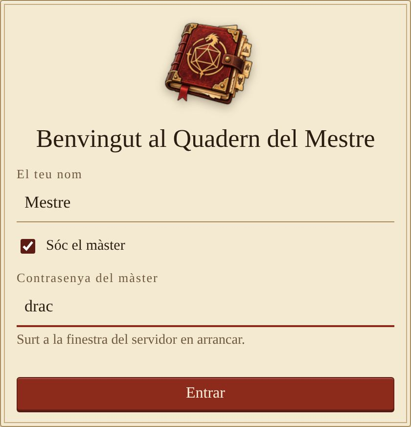

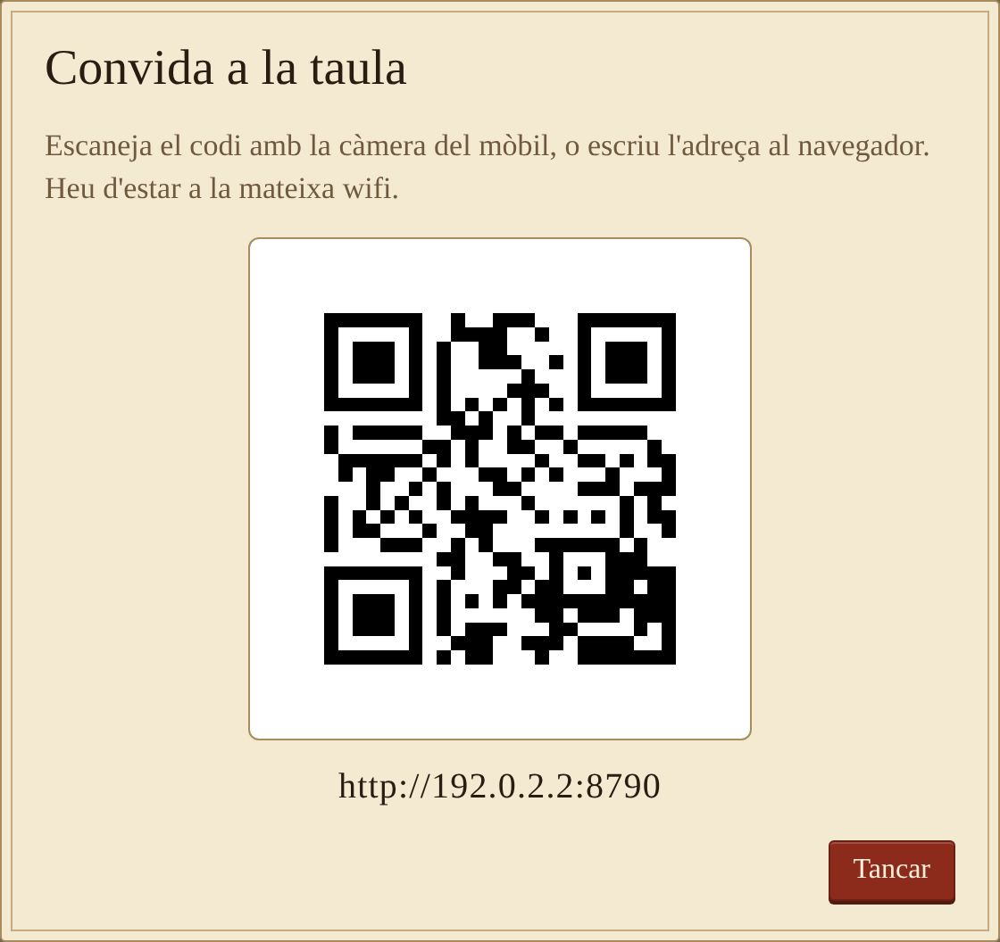

## Partides i partida d'exemple

A la pestanya **Partides** el màster crea, obri, duplica i esborra partides. Quan n'obri una, tots els connectats hi passen sols. Les esborrades van a `partides/esborrades/`.

**Crear la partida d'exemple** prepara «La cripta del rei oblidat»: un mapa amb boira, tres personatges, monstres, una sessió al diari, un document i notes del màster. És la manera més ràpida de provar-ho tot.

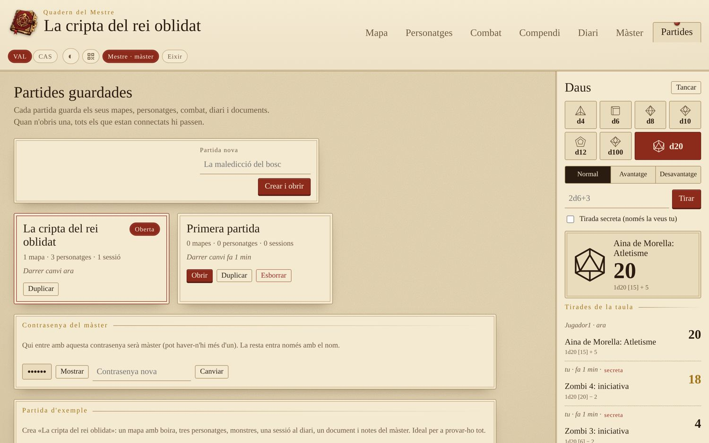

## El mapa

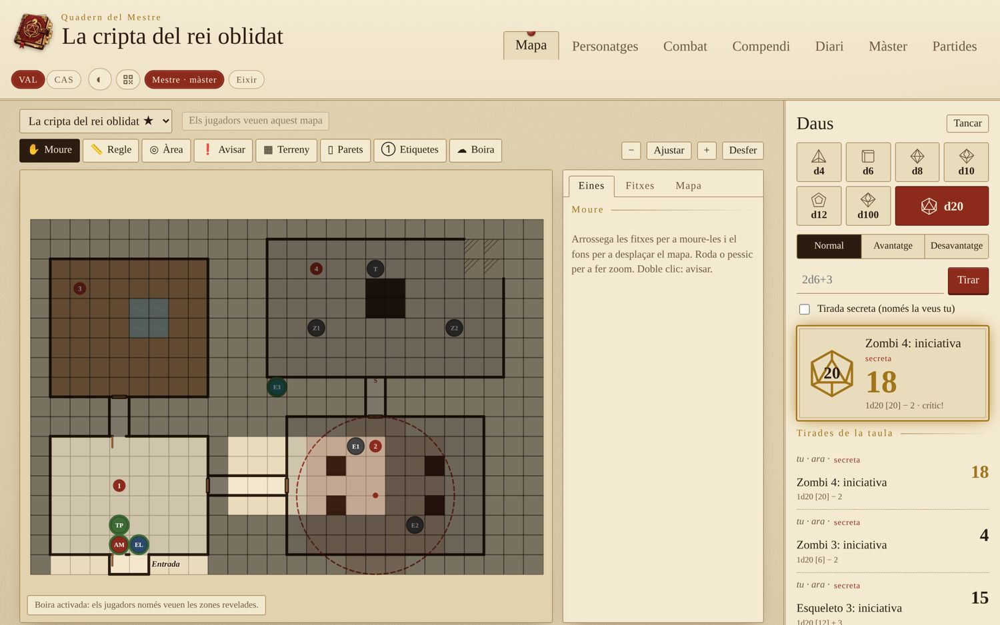

El màster tria quin mapa edita i prem **Ensenyar als jugadors** per a decidir quin veuen ells (★). Els jugadors sempre veuen eixe mapa.

| Eina | Què fa |
|---|---|
| **Moure** | Arrossega fitxes (els jugadors, només les seues) i desplaça el mapa. Roda o pessic per a fer zoom. |
| **Regle** | Mesura en metres i caselles. Cada casella són 1,5 m, també en diagonal. |
| **Àrea** | Esfera, con, línia o cub. Ressalta les caselles afectades i la veu tothom. |
| **Avisar** | Fa uns cercles en un punt perquè tothom hi mire. També amb doble clic. |

## Què veuen els jugadors

Amb la boira de guerra activada, el servidor no envia als jugadors res del que hi ha davall: ni el terreny, ni les etiquetes, ni les fitxes. No ho poden veure ni mirant el codi de la pàgina.

Les fitxes amagades tampoc arriben als jugadors, i les portes secretes els apareixen com a paret.

Al costat de cada fitxa es veu un anell amb la vida: verd, groc o roig.

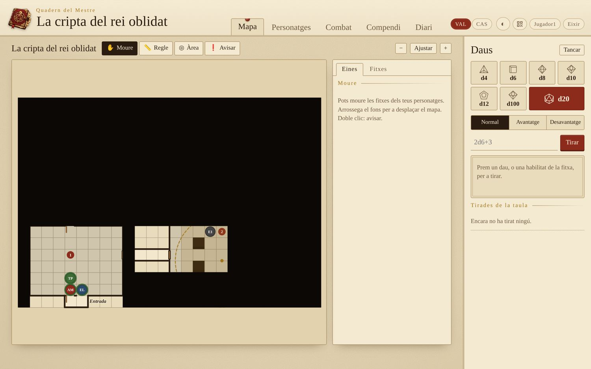

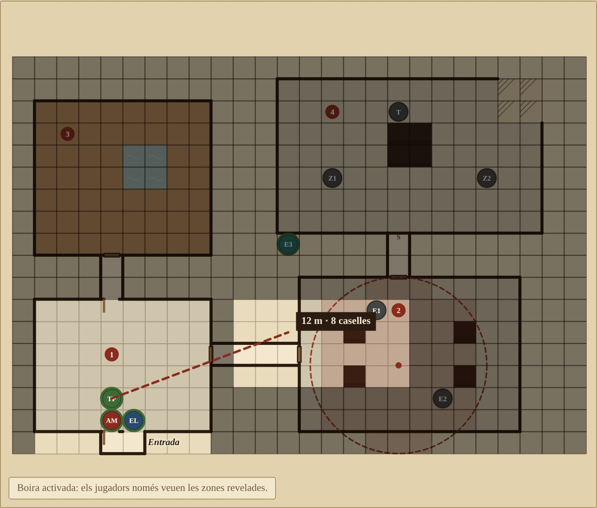

## Editar mapes

- **Terreny.** Tria un terreny i pinta amb el pinzell, un rectangle o omplir (com un pot de pintura que respecta les parets).
- **Parets i portes.** Fes clic a la vora entre dues caselles, o arrossega al llarg de les vores. Hi ha paret, porta, porta oberta, porta secreta i finestra. **Parets automàtiques** en posa al voltant de tot el terreny pintat.
- **Etiquetes.** Números de sala (com als mòduls d'aventura) o textos.
- **Boira.** Activa-la i arrossega rectangles per a revelar o amagar zones a mesura que el grup explora.

**Desfer** (o `Ctrl+Z`) torna enrere els canvis del mapa.

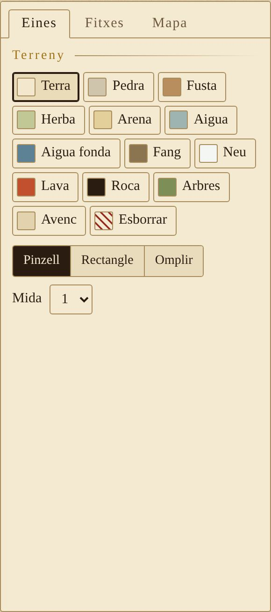

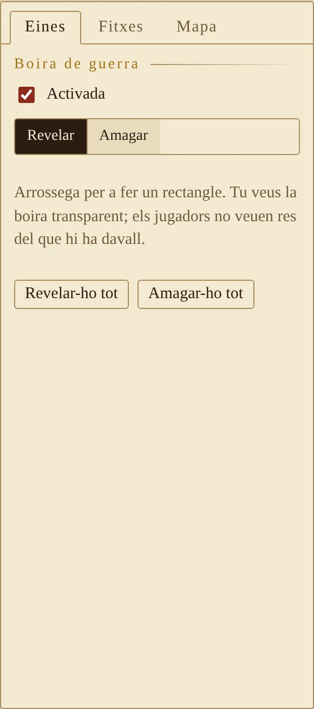

## Imatge de fons i fitxes

**Mapa a partir d'una imatge**

1. Puja la imatge (JPG, PNG, WebP; fins a 20 MB).
2. Canvia l'amplària en caselles fins que la quadrícula coincidisca amb la del dibuix.
3. Mou-la amb X i Y per a quadrar-la, i prem **Ajustar el mapa a la imatge**.

Damunt de la imatge pots pintar, posar parets i fer servir la boira igual.

**Fitxes**

A la pestanya **Fitxes**: afegir una fitxa, un monstre del SRD (va també al combat amb els seus PG) o tot el grup. Fes clic en una fitxa per a canviar-li el nom, la mida, el color o amagar-la.

**Guardar com a imatge** baixa el mapa en PNG, sense boira, per a imprimir-lo.

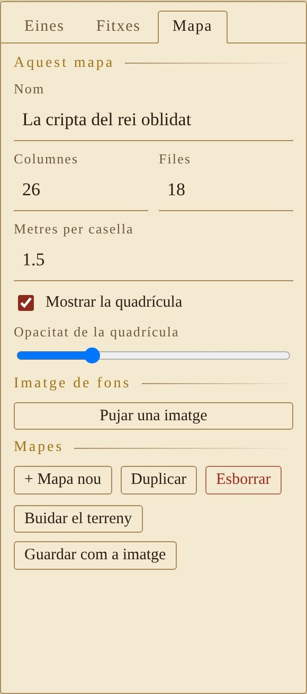

## Fitxes de personatge

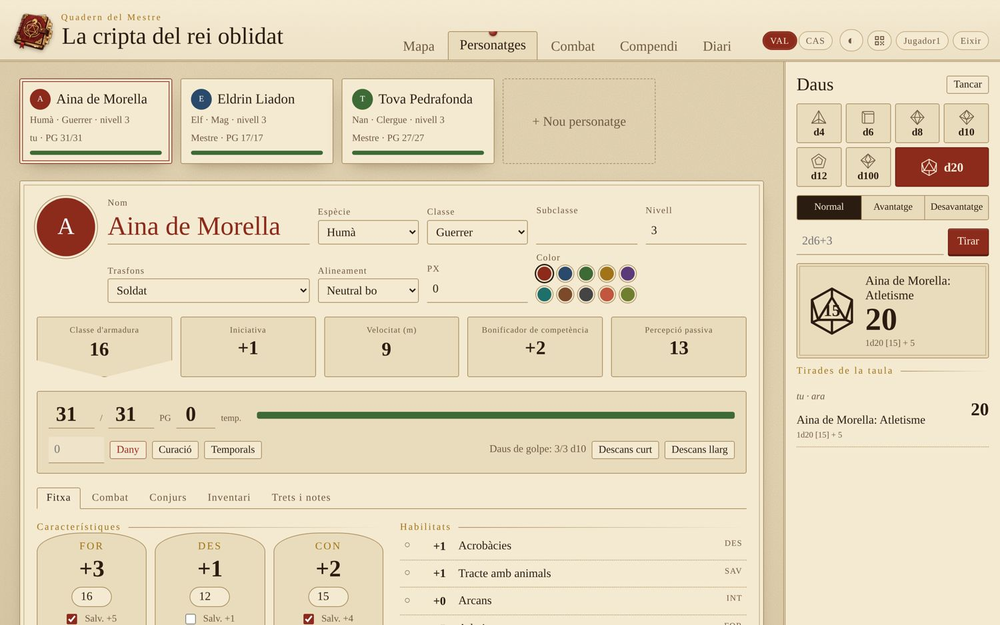

Cada jugador crea i edita les seues fitxes. El màster les pot editar totes, canviar-ne el jugador i crear PNJ, fins i tot amagats.

- El bonificador de competència, les salvacions, les habilitats i la iniciativa es calculen sols. Un clic al cercle d'una habilitat la fa competent (●) o experta (◆).
- **Dany**, **Curació** i **Temporals** apliquen els PG bé (primer gasten els temporals). **Descans curt** tira un dau de colp; **descans llarg** ho restableix tot.
- Prem el retrat per a pujar una imatge del teu personatge.

## Atacs, conjurs i inventari

- **Arma del SRD** calcula sola el bonificador d'atac i el dany. **Crític** dobla els daus.
- **Conjur del SRD** busca entre els 339 conjurs (filtrats per la teua classe). Un clic al nom mostra el text sencer.
- **Omplir espais segons la classe** posa els espais del teu nivell.

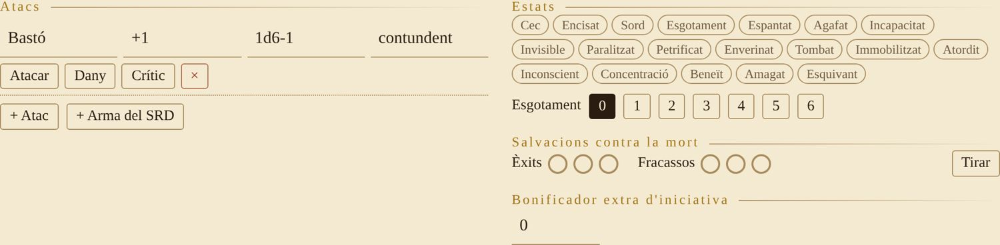

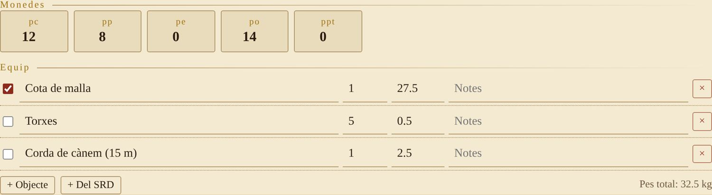

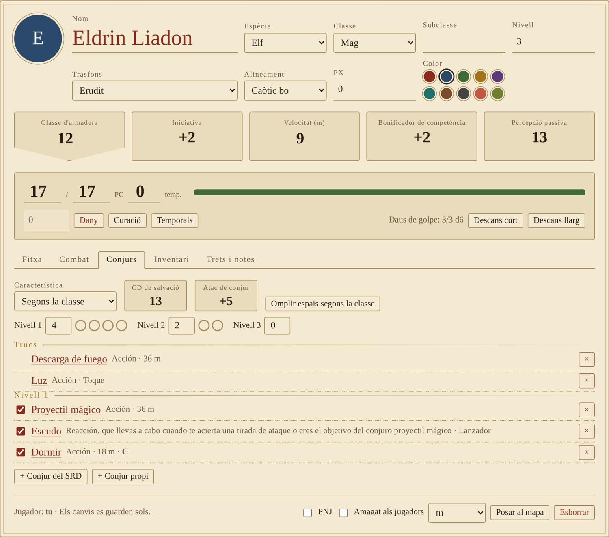

## Combat

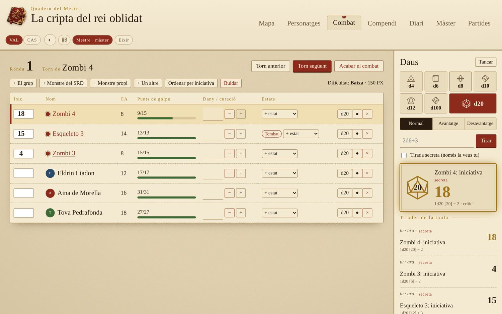

1. Afig el grup i els monstres (del SRD, propis o uns altres). Amb «Posar també al mapa» les fitxes hi van soles.
2. Escriu la iniciativa dels jugadors i prem **Començar el combat**: tira la dels monstres i ordena.
3. **Torn següent** avança. Al jugador a qui li toca li apareix un avís, i al mapa la seua fitxa porta un anell daurat.
4. Escriu el dany i prem **−** (o Intro). Els estats s'afigen amb el desplegable.

La dificultat de l'encontre (baixa, moderada, alta) es calcula amb els PX dels monstres i el nivell del grup.

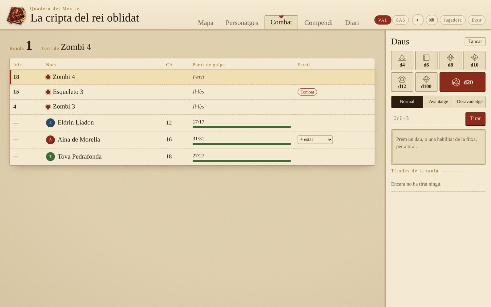

## Compendi i encontres

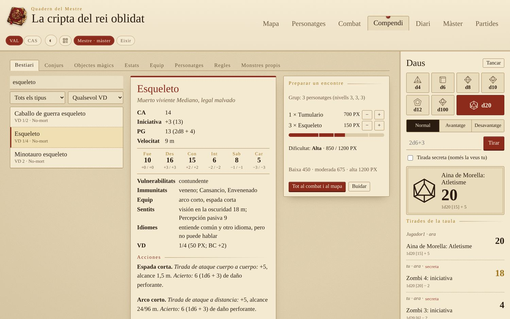

El compendi porta el SRD 5.2.1 sencer amb la traducció oficial al castellà de Wizards of the Coast: 330 criatures, 339 conjurs, objectes màgics, estats, equip, classes, espècies, dots i regles. Té cerca i filtres per tipus, VD, nivell, classe i raresa.

- **Al combat**, **Al combat i al mapa** o **A l'encontre** des de cada monstre.
- El **preparador d'encontres** suma els PX i mostra la dificultat per al teu grup.
- **Monstres propis:** crea criatures amb les seues estadístiques. Només les veu el màster.

Els jugadors veuen el compendi sense el bestiari.

## Diari i documents

**Diari de sessions.** Cadascú pot apuntar el resum d'una sessió, i tothom el pot llegir. Es pot fer servir `**negreta**`, `*cursiva*`, `# títols` i `- llistes`.

**Documents.** El màster prepara cartes, pistes o imatges. No les veu ningú fins que prem **Ensenyar**; llavors s'obrin soles a la pantalla dels jugadors. Es poden ensenyar a tothom o només a alguns.

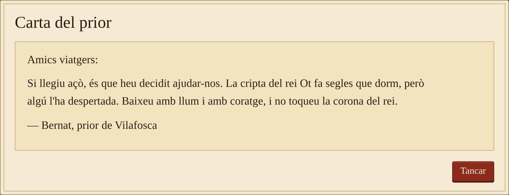

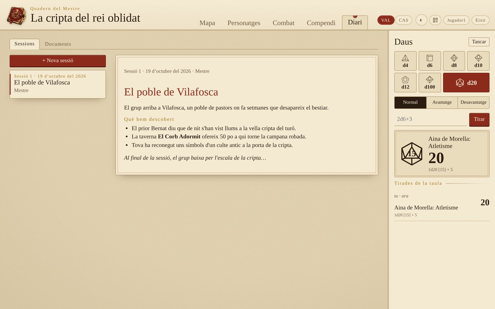

## La pestanya del màster

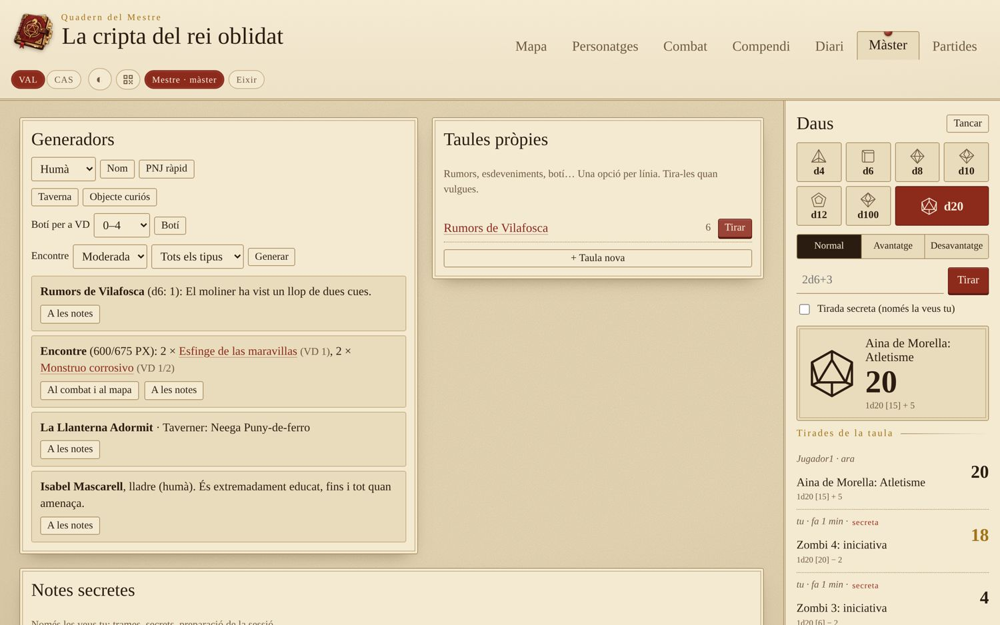

- **Generadors:** noms per espècie, PNJ ràpids amb un tret, tavernes, objectes curiosos, botí segons el VD (amb objectes màgics del SRD) i encontres aleatoris ajustats al grup.
- **Taules pròpies:** rumors, esdeveniments… Una opció per línia, i **Tirar**.
- **Notes secretes:** només les veu el màster. Els resultats dels generadors s'hi poden enviar amb un clic.

## Daus, mòbil, idioma i tema

**Daus.** El panell de daus és a la dreta (al mòbil, al botó **Daus**). Hi ha avantatge i desavantatge, expressions com `2d6+3` o `4d6kh3`, i el màster pot fer tirades secretes. Totes les tirades queden a «Tirades de la taula».

**Al mòbil.** Tot s'adapta a una columna. Al mapa, mou amb un dit i fes zoom amb dos.

**Idioma i tema.** **VAL** i **CAS** canvien l'idioma, i el botó de la lluna (◐ ☀ ☾) el tema: automàtic, clar o fosc. Cada aparell recorda els seus. El text del compendi és sempre la traducció oficial al castellà.

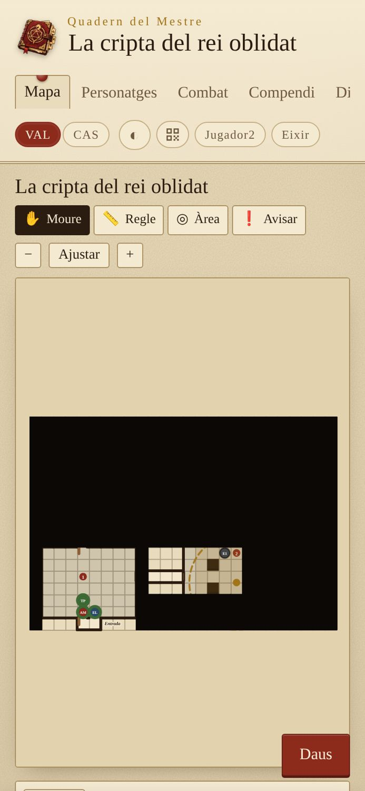

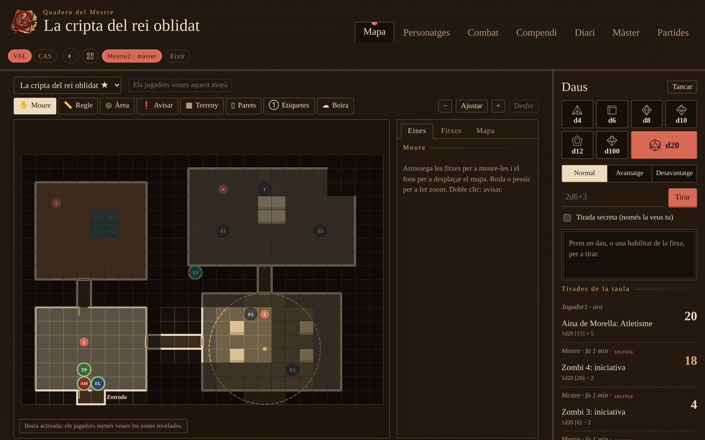

## Les dades i les còpies de seguretat

Cada partida es guarda a `partides/<nom>.json`, i les seues imatges a `partides/<nom>-fitxers/`. Els jugadors, les sessions i la contrasenya del màster es guarden a `quadern.json`.

El botó **Carpeta de partides** de la finestra obri la carpeta on està tot. Per a fer una còpia de seguretat, copia la carpeta sencera (la que conté `partides` i `quadern.json`) en un llapis USB o en el núvol. Per a recuperar-la, torna-la al seu lloc amb el Quadern tancat.

On es guarda depén de com l'has instal·lat; ho tens a la [guia d'instal·lació](guia-installacio.md#on-es-guarden-les-partides).

## Si alguna cosa no va

| Què passa | Què fer |
|---|---|
| Els altres no hi poden entrar | Han d'estar a la mateixa wifi. A Windows, permet el programa a «Xarxes privades» i comprova que la wifi és privada. A Linux, si tens tallafoc, obri el port: `sudo ufw allow 8767/tcp`. Algunes xarxes de convidats no deixen que els aparells es vegen. |
| He oblidat la contrasenya del màster | Està a la finestra del Quadern. També pots arrancar amb `--contrasenya` per a posar-ne una de nova. |
| «El port ja està en ús» | Ja hi ha un altre Quadern obert. Tanca'l o arranca amb `--port 9002`. |
| Apareix «S'ha perdut la connexió» | El Quadern s'ha aturat o l'ordinador s'ha adormit. Quan torne, la pàgina es reconnecta sola. |
| Un jugador no pot moure la seua fitxa | La fitxa del mapa ha d'estar lligada al seu personatge, i el personatge ha de ser seu (el màster ho canvia a baix de la fitxa). |

## Llicències

El Quadern del Mestre és programari lliure amb llicència GPL-3.0 o posterior.

El compendi inclou material del System Reference Document 5.2.1 («SRD 5.2.1») de Wizards of the Coast LLC, disponible a https://www.dndbeyond.com/srd, amb llicència Creative Commons Reconeixement 4.0 Internacional (https://creativecommons.org/licenses/by/4.0/legalcode).

El logo s'ha generat amb IA, i el programa i aquesta guia s'han escrit amb ajuda d'un assistent d'IA. Projecte de fans no oficial, sense relació amb Wizards of the Coast.
