# Manual de usuario

Guía de uso del Quadern del Mestre, el ayudante libre para dirigir partidas de rol de 5.ª edición: mapas con niebla de guerra, fichas, combate, compendio SRD 5.2.1, diario y documentos.

Para instalarlo, consulta la [guía de instalación](guia-instalacion.md).

## Qué es y qué necesitas

El Quadern del Mestre es una página web que funciona en casa, sin Internet. Un ordenador hace de servidor y el resto de la mesa entra desde el navegador del móvil, la tableta o el portátil. Todos ven los cambios al momento.

Hay dos papeles: el **máster**, que lo ve y lo controla todo, y los **jugadores**, que ven el mapa que el máster enseña, llevan su ficha y leen el diario y los documentos.

| Sección | Qué contiene |
|---|---|
| **Mapa** | Editor de mapas, fichas, niebla de guerra, regla y áreas de efecto. |
| **Personajes** | Fichas completas de 5.ª edición (2024) con tiradas. |
| **Combate** | Iniciativa, turnos, puntos de golpe, estados y dificultad. |
| **Compendio** | El SRD 5.2.1 entero: bestiario, conjuros, objetos, estados, equipo y reglas. |
| **Diario** | Resúmenes de sesión y documentos para los jugadores. |
| **Máster** | Generadores, tablas propias y notas secretas (solo el máster). |
| **Partidas** | Partidas guardadas, contraseña y partida de ejemplo (solo el máster). |

**Qué hace falta:**

- **El ordenador servidor:** Windows 10 u 11, o Linux. Consulta la [guía de instalación](guia-instalacion.md).
- **Los jugadores:** cualquier dispositivo con navegador, conectado a la misma wifi que el servidor. No tienen que instalar nada.

## Arrancar el Quadern

Abre **Quadern del Mestre** desde el menú Inicio (Windows) o desde el menú de aplicaciones (Linux). Se abren dos cosas:

- **La ventana del Quadern**, con la dirección para los demás, un código QR y la contraseña del máster. Mientras esté abierta, el Quadern funciona.
- **El navegador**, ya con la app.

En la ventana encontrarás:

- **La dirección para los demás**, por ejemplo `http://192.168.1.40:8767`, y el **código QR** que la lleva dentro.
- **La contraseña del máster.** La primera vez se crea una al azar con una palabra y un número (como `drac427`) y se recuerda. La puedes cambiar en la pestaña Partidas.
- **La partida abierta.**
- Los botones **Abrir en el navegador**, **Carpeta de partidas** (abre la carpeta donde se guarda todo) y **Detener**.

Para acabar, pulsa **Detener** o cierra la ventana. Antes de cerrarse lo guarda todo, y los jugadores se desconectan.

> Si el Quadern se usa desde un terminal (por ejemplo, en un servidor sin pantalla), la misma información, con el QR, sale en el terminal. Las opciones están en la [guía de instalación](guia-instalacion.md).

## Entrar e invitar

1. Abre la dirección en el navegador, o escanea el QR con la cámara del móvil.
2. Escribe tu nombre. Si eres el máster, marca **Soy el máster** y escribe la contraseña.
3. El navegador recuerda quién eres. La próxima vez entrarás directamente.

Puede haber más de un máster. Para entrar con otro nombre, pulsa **Salir**.

Si llega alguien con la partida empezada, el botón del QR de arriba a la derecha muestra el código en grande.

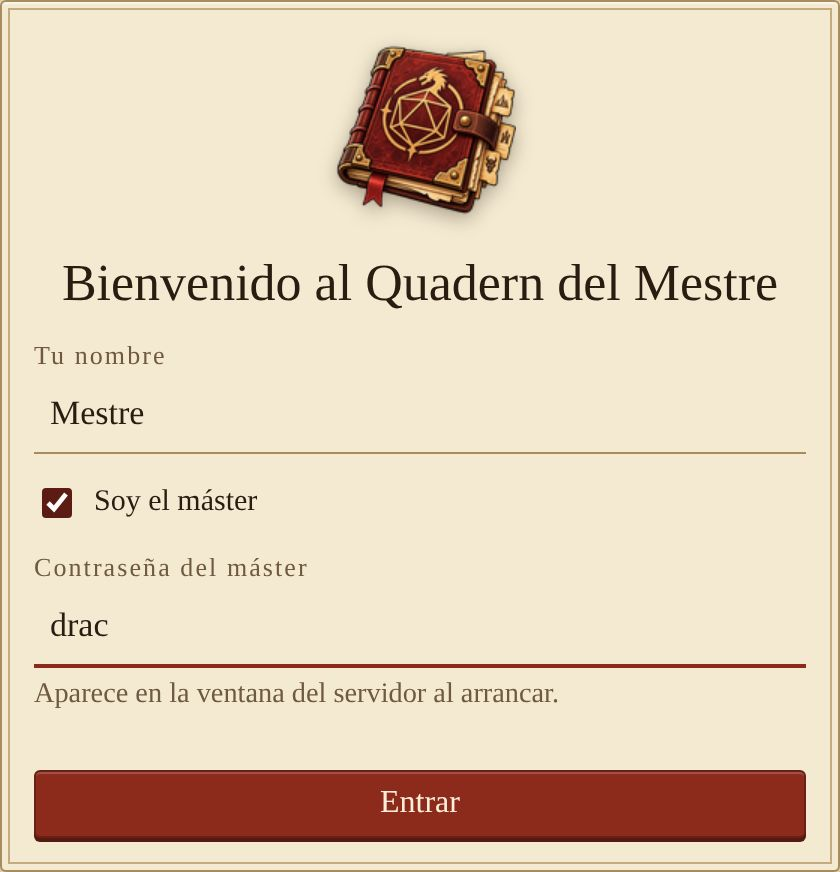

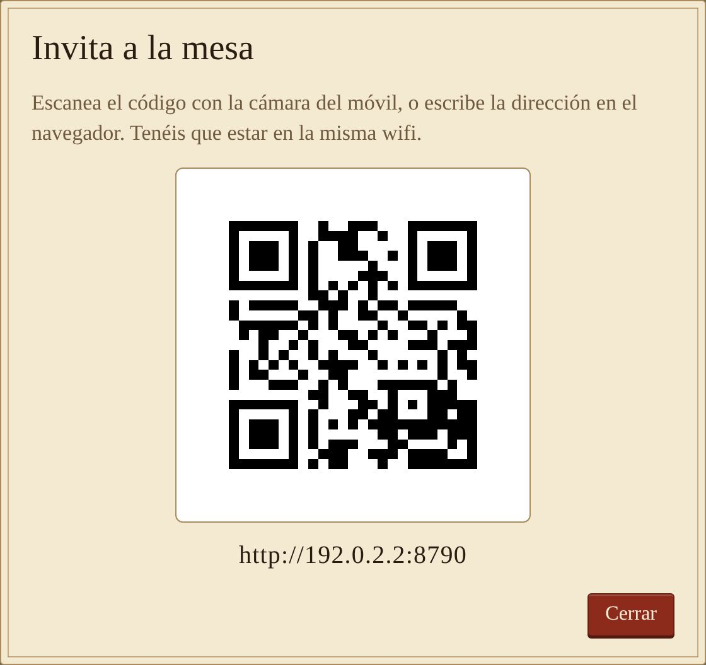

## Partidas y partida de ejemplo

En la pestaña **Partidas** el máster crea, abre, duplica y borra partidas. Cuando abre una, todos los conectados pasan a ella solos. Las borradas van a `partides/esborrades/`.

**Crear la partida de ejemplo** prepara «La cripta del rey olvidado»: un mapa con niebla, tres personajes, monstruos, una sesión en el diario, un documento y notas del máster. Es la manera más rápida de probarlo todo.

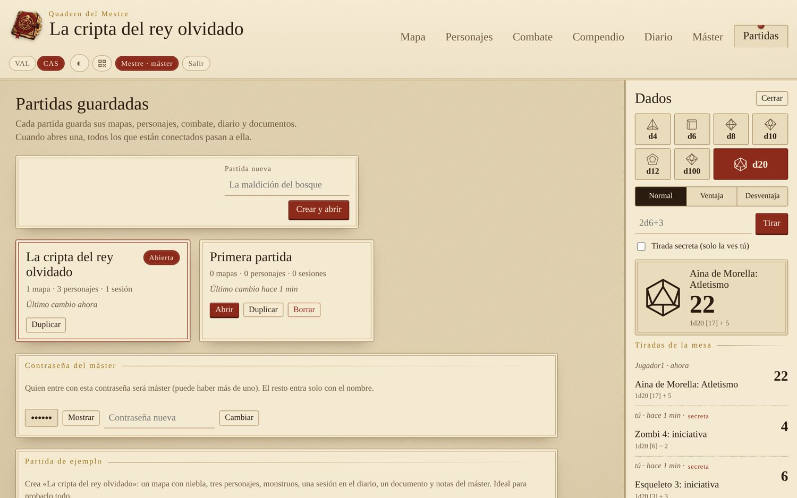

## El mapa

El máster elige qué mapa edita y pulsa **Enseñar a los jugadores** para decidir cuál ven ellos (★). Los jugadores siempre ven ese mapa.

| Herramienta | Qué hace |
|---|---|
| **Mover** | Arrastra fichas (los jugadores, solo las suyas) y desplaza el mapa. Rueda o pellizco para hacer zoom. |
| **Regla** | Mide en metros y casillas. Cada casilla son 1,5 m, también en diagonal. |
| **Área** | Esfera, cono, línea o cubo. Resalta las casillas afectadas y la ve todo el mundo. |
| **Señalar** | Hace unos círculos en un punto para que todos miren. También con doble clic. |

## Qué ven los jugadores

Con la niebla de guerra activada, el servidor no envía a los jugadores nada de lo que hay debajo: ni el terreno, ni las etiquetas, ni las fichas. No lo pueden ver ni mirando el código de la página.

Las fichas ocultas tampoco llegan a los jugadores, y las puertas secretas les aparecen como pared.

Alrededor de cada ficha se ve un anillo con la vida: verde, amarillo o rojo.

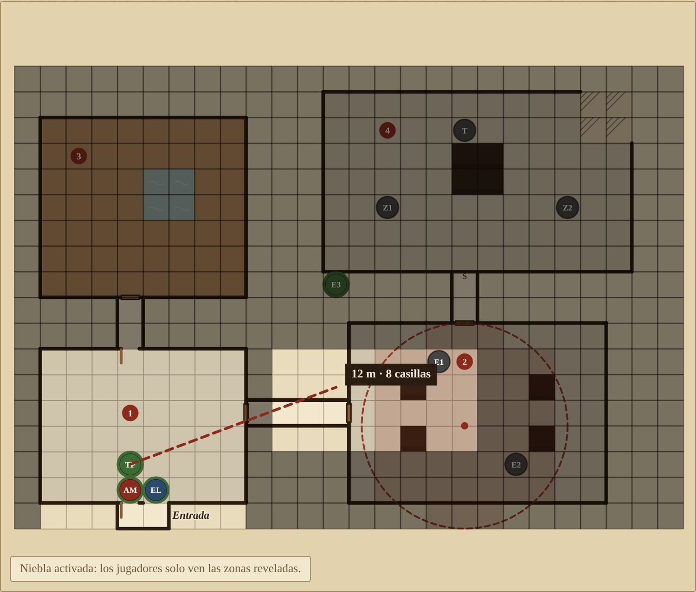

## Editar mapas

- **Terreno.** Elige un terreno y pinta con el pincel, un rectángulo o rellenar (como un bote de pintura que respeta las paredes).
- **Paredes y puertas.** Haz clic en el borde entre dos casillas, o arrastra a lo largo de los bordes. Hay pared, puerta, puerta abierta, puerta secreta y ventana. **Paredes automáticas** las pone alrededor de todo el terreno pintado.
- **Etiquetas.** Números de sala (como en los módulos de aventura) o textos.
- **Niebla.** Actívala y arrastra rectángulos para revelar u ocultar zonas a medida que el grupo explora.

**Deshacer** (o `Ctrl+Z`) vuelve atrás los cambios del mapa.

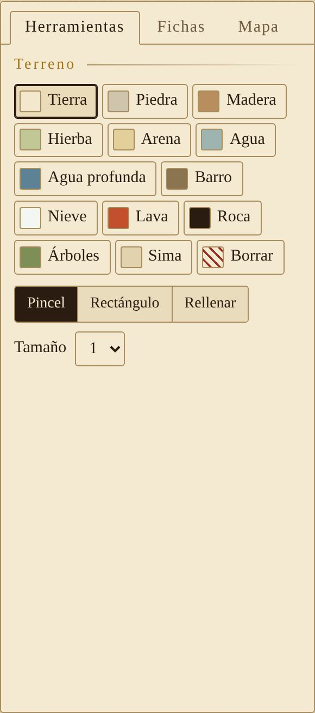

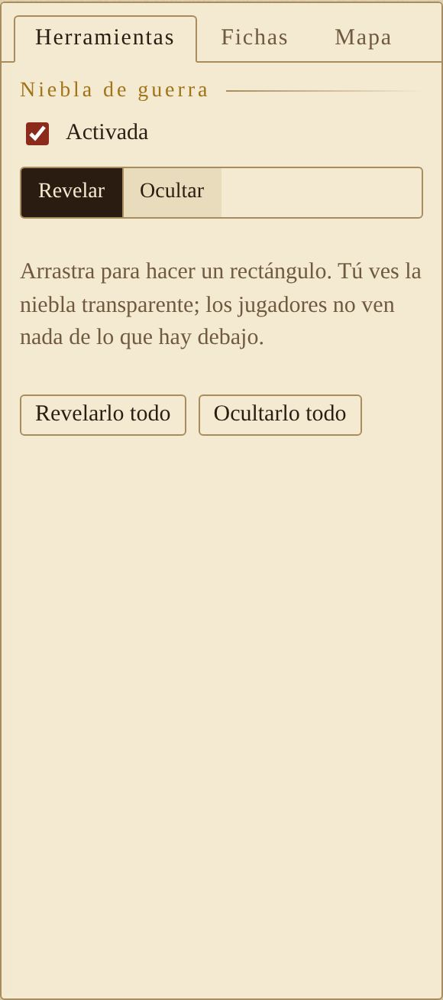

## Imagen de fondo y fichas

**Mapa a partir de una imagen**

1. Sube la imagen (JPG, PNG, WebP; hasta 20 MB).
2. Cambia la anchura en casillas hasta que la cuadrícula coincida con la del dibujo.
3. Muévela con X e Y para cuadrarla, y pulsa **Ajustar el mapa a la imagen**.

Encima de la imagen puedes pintar, poner paredes y usar la niebla igual.

**Fichas**

En la pestaña **Fichas**: añadir una ficha, un monstruo del SRD (va también al combate con sus PG) o todo el grupo. Haz clic en una ficha para cambiarle el nombre, el tamaño, el color u ocultarla.

**Guardar como imagen** descarga el mapa en PNG, sin niebla, para imprimirlo.

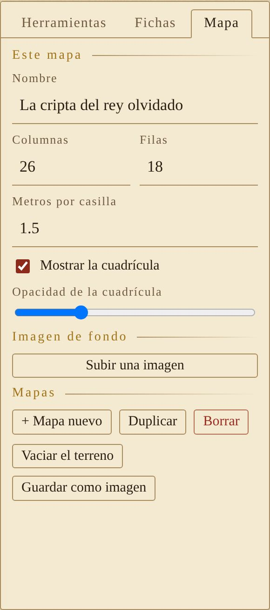

## Fichas de personaje

Cada jugador crea y edita sus fichas. El máster las puede editar todas, cambiarles el jugador y crear PNJ, incluso ocultos.

- El bonificador por competencia, las salvaciones, las habilidades y la iniciativa se calculan solos. Un clic en el círculo de una habilidad la hace competente (●) o con pericia (◆).
- **Daño**, **Curación** y **Temporales** aplican los PG bien (primero gastan los temporales). **Descanso corto** tira un dado de golpe; **descanso largo** lo restablece todo.
- Pulsa el retrato para subir una imagen de tu personaje.

## Ataques, conjuros e inventario

- **Arma del SRD** calcula sola el bonificador de ataque y el daño. **Crítico** dobla los dados.
- **Conjuro del SRD** busca entre los 339 conjuros (filtrados por tu clase). Un clic en el nombre muestra el texto entero.
- **Rellenar espacios según la clase** pone los espacios de tu nivel.

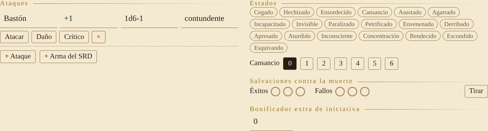

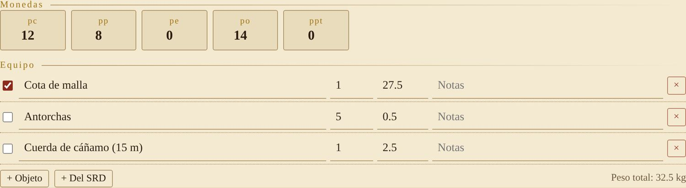

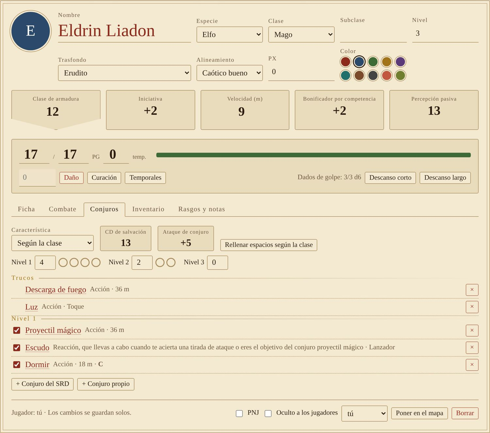

## Combate

1. Añade el grupo y los monstruos (del SRD, propios u otros). Con «Poner también en el mapa» las fichas van solas.
2. Escribe la iniciativa de los jugadores y pulsa **Empezar el combate**: tira la de los monstruos y ordena.
3. **Turno siguiente** avanza. Al jugador al que le toca le aparece un aviso, y en el mapa su ficha lleva un anillo dorado.
4. Escribe el daño y pulsa **−** (o Intro). Los estados se añaden con el desplegable.

La dificultad del encuentro (baja, moderada, alta) se calcula con los PX de los monstruos y el nivel del grupo.

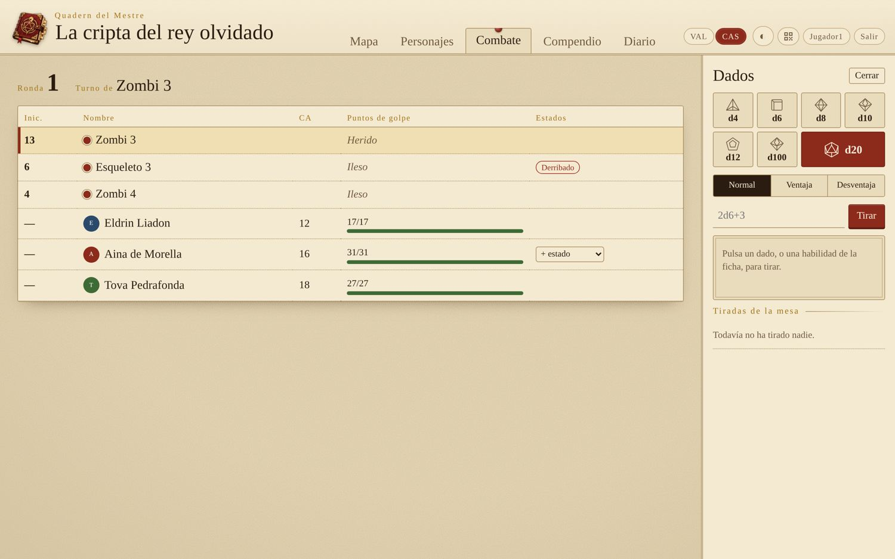

## Compendio y encuentros

El compendio lleva el SRD 5.2.1 entero con la traducción oficial al castellano de Wizards of the Coast: 330 criaturas, 339 conjuros, objetos mágicos, estados, equipo, clases, especies, dotes y reglas. Tiene búsqueda y filtros por tipo, VD, nivel, clase y rareza.

- **Al combate**, **Al combate y al mapa** o **Al encuentro** desde cada monstruo.
- El **preparador de encuentros** suma los PX y muestra la dificultad para tu grupo.
- **Monstruos propios:** crea criaturas con sus estadísticas. Solo las ve el máster.

Los jugadores ven el compendio sin el bestiario.

## Diario y documentos

**Diario de sesiones.** Cada uno puede apuntar el resumen de una sesión, y todo el mundo lo puede leer. Se puede usar `**negrita**`, `*cursiva*`, `# títulos` y `- listas`.

**Documentos.** El máster prepara cartas, pistas o imágenes. No las ve nadie hasta que pulsa **Enseñar**; entonces se abren solas en la pantalla de los jugadores. Se pueden enseñar a todos o solo a algunos.

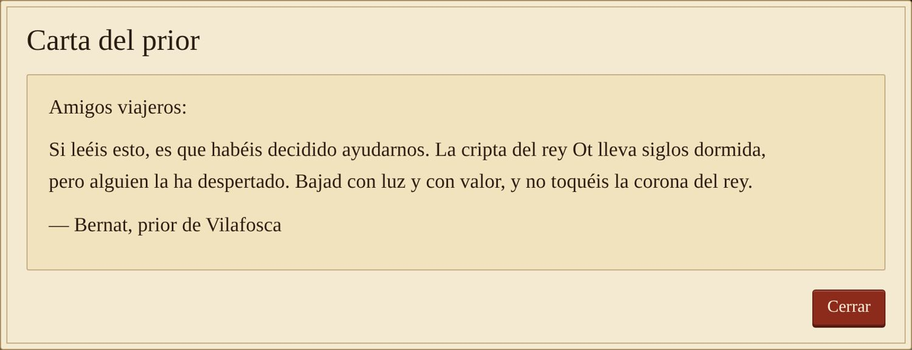

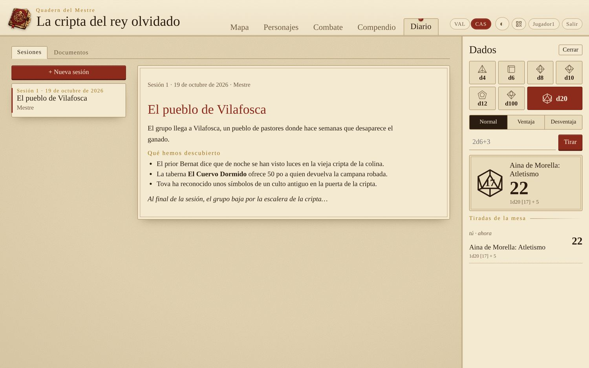

## La pestaña del máster

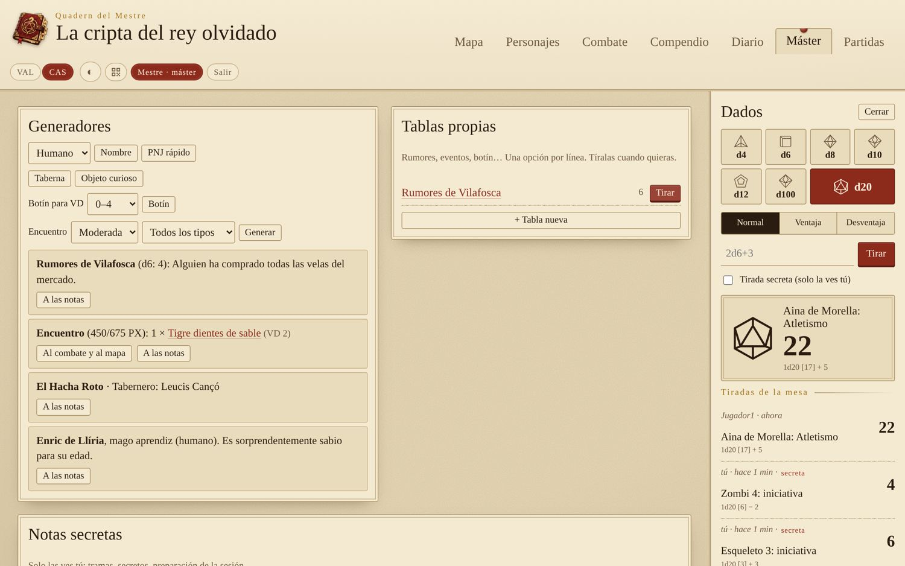

- **Generadores:** nombres por especie, PNJ rápidos con un rasgo, tabernas, objetos curiosos, botín según el VD (con objetos mágicos del SRD) y encuentros aleatorios ajustados al grupo.
- **Tablas propias:** rumores, eventos… Una opción por línea, y **Tirar**.
- **Notas secretas:** solo las ve el máster. Los resultados de los generadores se pueden enviar con un clic.

## Dados, móvil, idioma y tema

**Dados.** El panel de dados está a la derecha (en el móvil, en el botón **Dados**). Hay ventaja y desventaja, expresiones como `2d6+3` o `4d6kh3`, y el máster puede hacer tiradas secretas. Todas las tiradas quedan en «Tiradas de la mesa».

**En el móvil.** Todo se adapta a una columna. En el mapa, mueve con un dedo y haz zoom con dos.

**Idioma y tema.** **VAL** y **CAS** cambian el idioma, y el botón de la luna (◐ ☀ ☾) el tema: automático, claro u oscuro. Cada dispositivo recuerda los suyos. El texto del compendio es siempre la traducción oficial al castellano.

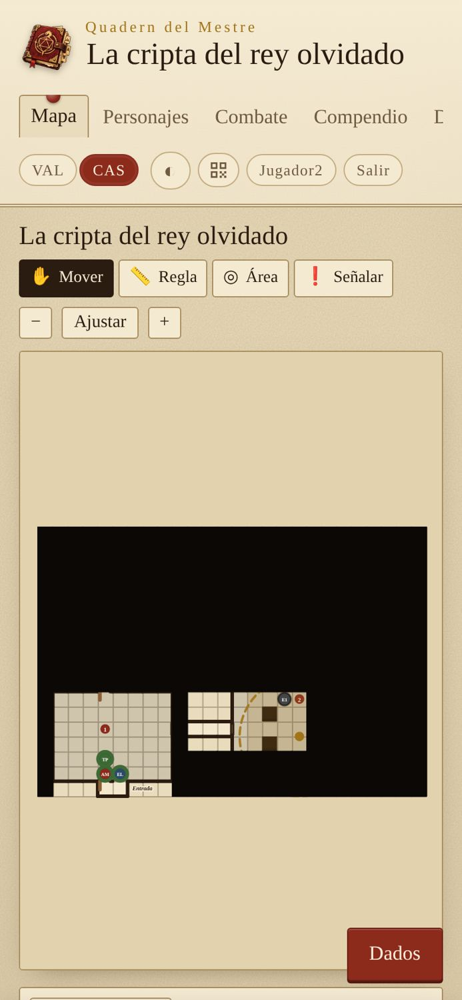

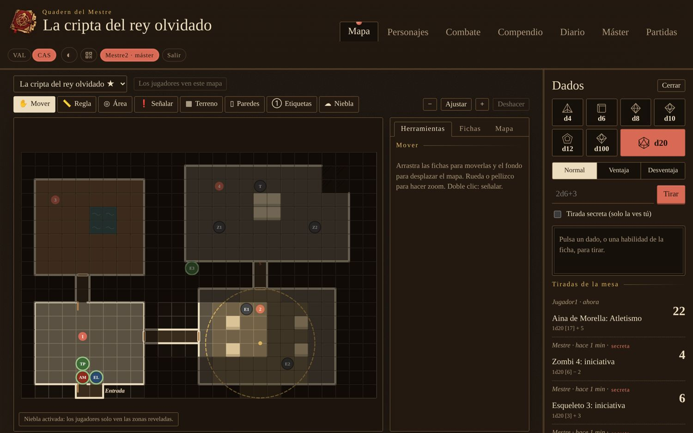

## Los datos y las copias de seguridad

Cada partida se guarda en `partides/<nombre>.json`, y sus imágenes en `partides/<nombre>-fitxers/`. Los jugadores, las sesiones y la contraseña del máster se guardan en `quadern.json`.

El botón **Carpeta de partidas** de la ventana abre la carpeta donde está todo. Para hacer una copia de seguridad, copia la carpeta entera (la que contiene `partides` y `quadern.json`) en un lápiz USB o en la nube. Para recuperarla, devuélvela a su sitio con el Quadern cerrado.

Dónde se guarda depende de cómo lo has instalado; lo tienes en la [guía de instalación](guia-instalacion.md#dónde-se-guardan-las-partidas).

## Si algo no funciona

| Qué pasa | Qué hacer |
|---|---|
| Los demás no pueden entrar | Tienen que estar en la misma wifi. En Windows, permite el programa en «Redes privadas» y comprueba que la wifi es privada. En Linux, si tienes cortafuegos, abre el puerto: `sudo ufw allow 8767/tcp`. Algunas redes de invitados no dejan que los dispositivos se vean. |
| He olvidado la contraseña del máster | Está en la ventana del Quadern. También puedes arrancar con `--contrasenya` para poner una nueva. |
| «El puerto ya está en uso» | Ya hay otro Quadern abierto. Ciérralo o arranca con `--port 9002`. |
| Aparece «Se ha perdido la conexión» | El Quadern se ha detenido o el ordenador se ha dormido. Cuando vuelva, la página se reconecta sola. |
| Un jugador no puede mover su ficha | La ficha del mapa tiene que estar ligada a su personaje, y el personaje tiene que ser suyo (el máster lo cambia abajo de la ficha). |

## Licencias

El Quadern del Mestre es software libre con licencia GPL-3.0 o posterior.

Esta obra incluye material procedente del documento de referencia del sistema 5.2.1 («SRD 5.2.1») de Wizards of the Coast LLC, disponible en https://www.dndbeyond.com/srd. La licencia sobre el SRD 5.2.1 se concede de acuerdo con la licencia internacional de atribución/reconocimiento 4.0 de Creative Commons, disponible en https://creativecommons.org/licenses/by/4.0/legalcode.

El logo se ha generado con IA, y el programa y esta guía se han escrito con ayuda de un asistente de IA. Proyecto de fans no oficial, sin relación con Wizards of the Coast.
